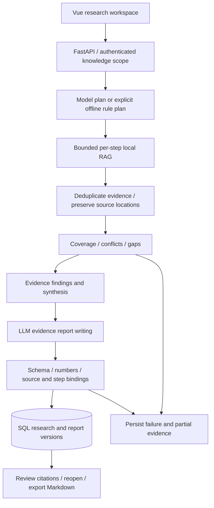

# InsightOS — Evidence-Based AI Research Agent

InsightOS MVP v1.0 turns a private document collection into cited answers and structured research reports. It combines local RAG with a bounded, persistent agent workflow: plan questions, retrieve evidence, synthesize findings, write a report, validate citations, and save an exportable version.

Built as a personal AI Agent portfolio project. The interface is primarily Chinese. Research orchestration is a **custom Python/SQL workflow, not LangGraph**. LangGraph appears in research source documents, not as the application's framework.

## Features

- Knowledge-base management, document ingestion, indexing status, versions, and access scope.
- Ordinary RAG chat with streaming drafts, final verification, cited excerpts, and conversation history.
- Multi-step research plans, per-step retrieval, deduplicated evidence, conflicts, and gaps.
- Evidence-bound findings and analysis, followed by an eight-section research report.
- Source revision, location, permission, numeric, and evidence/step binding checks.
- Saved research and report versions, history navigation, and Markdown export.
- Research evaluation that separates citation validity from semantic quality review.

The earlier RAG platform capabilities remain in the source, including organization permissions, asynchronous ingestion, optional Redis/PostgreSQL deployment, model adapters, and evaluation tools. MVP research works on selected uploaded knowledge bases; it does not autonomously browse the web.

## Agent research workflow



The SQL-backed worker records phase events and partial evidence, uses leases to fence writes, and checks cancellation and resource limits. Standard research permits up to four steps, two retrieval rounds per step, eight retrieval operations, and twelve evidence groups. Automatic report writing extends the workflow budget. Failed or interrupted tasks remain visible; completion is not forced by weakening evidence checks.

## RAG and evidence verification

Documents are parsed and chunked with source metadata, including PDF pages and Markdown section/line positions where available. Retrieval combines Qdrant dense candidates with SQL-backed BM25, fuses ranks with RRF, and optionally applies a Cross-Encoder. Knowledge permissions and active versions constrain candidates. Research adds topic/body relevance and coverage checks, retaining gaps when evidence is insufficient.

Reports bind claims to evidence IDs and research steps. Validation checks source identity, revision, location, excerpt attribution, and permitted evidence/step relationships. The default `numeric` verifier performs partial citation/numeric checks. **Valid citations do not prove factual accuracy or semantic entailment.** Synthesized claims can remain `NEEDS_REVIEW` with `semantic_checked=false`. Optional LLM verification does not replace human review.

## Stack and project structure

| Area | Implementation |
| --- | --- |
| Frontend | Vue 3, TypeScript, Vite, Lucide icons |
| API / persistence | FastAPI, Pydantic, SQLAlchemy, Alembic; SQLite locally, PostgreSQL deployment option |
| Retrieval | Qdrant, BM25, jieba, RRF; optional SentenceTransformers / Cross-Encoder |
| Models | LangChain OpenAI-compatible and Ollama adapters; DeepSeek used in recorded real validation |
| Documents | PyPDF, python-docx, HTML/text parsers; optional OCR/vision |
| Checks | pytest, Ruff, Node tests, vue-tsc, Vite build; optional Ragas |

```text
.
├── backend/
│   ├── app/api/              # Auth, knowledge, chat, research, reports, evaluation
│   ├── app/services/         # Retrieval, verification and research/report workflows
│   ├── app/*schemas.py       # API and structured model-output contracts
│   ├── migrations/           # Alembic schema history
│   ├── tests/                # Offline regressions and historical replay tests
│   └── pyproject.toml
├── frontend/
│   ├── src/components/       # Workspace, research, report and evaluation UI
│   ├── tests/
│   └── package-lock.json
├── scripts/                  # Development and validation utilities
├── examples/                 # Small demo documents and benchmark examples
├── docs/                     # Architecture, deployment and publication notes
├── monitoring/               # Optional Prometheus configuration
├── .github/workflows/ci.yml
├── .env.example
└── docker-compose.yml
```

Runtime databases, vector indexes, uploads, reports, credentials, and model weights are excluded from new commits. Private workspace directories `evaluation/`, `knowledge_base/`, and `project_docs/` are outside this repository. Legacy package identifiers remain `rag-knowledge-assistant` / `zhiheng-knowledge-os`.

## Setup and startup

Use **Python 3.12 and Node.js 22**. Commands run from the directory containing this README, not the parent workspace. A fresh clone starts with an empty knowledge base; private data and caches are not distributed.

```powershell
python -m venv .venv
.\.venv\Scripts\Activate.ps1
python -m pip install -e './backend[dev]'
# Fresh clone only: do not overwrite an existing .env.
Copy-Item .env.example .env
cd frontend
npm ci
cd ..
```

On macOS/Linux activate with `source .venv/bin/activate`; copy the example with `cp .env.example .env` only when `.env` does not exist. Run the API from `backend/` so relative data paths and `.env` discovery resolve correctly.

The default example uses **SQLite + Qdrant local + hash embeddings + extractive output**, with no model calls. Hash embeddings demonstrate plumbing, not semantic retrieval or AI report writing.

For semantic retrieval install `python -m pip install -e './backend[dev,ml]'` and configure:

```dotenv
RAG_EMBEDDING_PROVIDER=sentence-transformers
RAG_EMBEDDING_MODEL=BAAI/bge-small-zh-v1.5
RAG_EMBEDDING_DIMENSION=512
```

Weights download on first use. For AI planning, synthesis and report writing, set `RAG_LLM_BASE_URL`, `RAG_LLM_MODEL`, and your own `RAG_LLM_API_KEY`, with `RAG_LLM_PROVIDER=openai` for compatible services. The DeepSeek base URL is `https://api.deepseek.com`; choose a model available to your account. DeepSeek chat endpoints cannot supply embeddings: use local BGE or an independent embedding provider. Model calls send selected excerpts to the configured provider and may incur charges.

Generate your own `RAG_SECRET_KEY` and keep `.env` private. See [.env.example](.env.example) and [deployment](docs/deployment.md) for optional embedding credentials, Qdrant keys, database/Redis credentials, metrics tokens and OIDC settings. Do not change embedding model/dimension on an existing index; use a new database and data directory for a new profile.

Start the API in one terminal:

```powershell
cd backend
python -m uvicorn app.main:app --host 127.0.0.1 --port 8010
```

Start the UI in another terminal:

```powershell
cd frontend
npm run dev
```

Open [the workspace](http://127.0.0.1:5173) or [API documentation](http://127.0.0.1:8010/docs). Vite proxies `/api` to port 8010. Without Redis, ingestion and research workers run in the API process. Use a single API process with Qdrant local.

Register a local account, create a knowledge base, upload a permitted document or an `examples/` file, and wait for indexing. Select that knowledge base for chat or deep research. Follow the plan/evidence, inspect final citations, reopen history, and export Markdown. AI report writing needs model configuration. Missing evidence or invalid bindings can produce a failed task instead of a report.

The legacy one-terminal launcher checks the earlier UI title; use the explicit commands above for this MVP. Docker and production options remain in [deployment](docs/deployment.md) and [enterprise](docs/enterprise.md); those guides describe the broader inherited platform.

## Validation and known limits

The private **2026-11-01 final browser E2E record** reports one successful fresh task: real model planning → local RAG → synthesis → DeepSeek report writing → automatic save → citation inspection → history version navigation → browser Markdown download. Downloaded Markdown matched saved content byte for byte. It used three normal model calls. This is one recorded sample, not a general success rate or performance benchmark. An earlier acceptance run failed on an evidence gap; later success does not erase that failure.

The subsequent ordinary-chat repair record reports **286 backend tests and 8 frontend tests passing** in the original workspace. These include private historical fixtures. Fresh public clones explicitly skip archive-dependent tests and have different totals. See [MVP validation notes](docs/mvp-validation.md) for provenance and publication checks.

Semantic research quality remains **QUALITY_PENDING_HUMAN_REVIEW**. No accuracy, hallucination-rate, cost guarantee, load capacity, or multi-domain reliability is claimed. Numeric checks are partial; cross-language heuristics, planning scope and source sufficiency can fail. Optional OCR/models/evaluation need additional resources. Python versions are bounded but not locked, so exact cross-machine dependency reproduction is not guaranteed.

## Offline checks and demo media

```powershell
python scripts/test-offline.py -q -rs
python -m ruff check backend scripts
cd frontend
npm test
npm run build
```

The offline runner blocks non-loopback connections, disables provider configuration, and uses temporary storage. Historical archive-dependent tests skip when their private material is absent. Real-provider smoke, benchmark and evaluation tools are separate and can call models.

Portfolio screenshot slots: add reviewed **actual MVP screenshots** under `docs/images/` for home/knowledge selection, research progress/evidence, report/citations, and history/export. No MVP screenshot is fabricated or claimed here. Legacy screenshots and raw acceptance JSON are deliberately omitted from this clean release.

The existing [MIT license](LICENSE) is preserved. Third-party documents, models and dependencies retain their own terms; private research materials and reports are not bundled.
